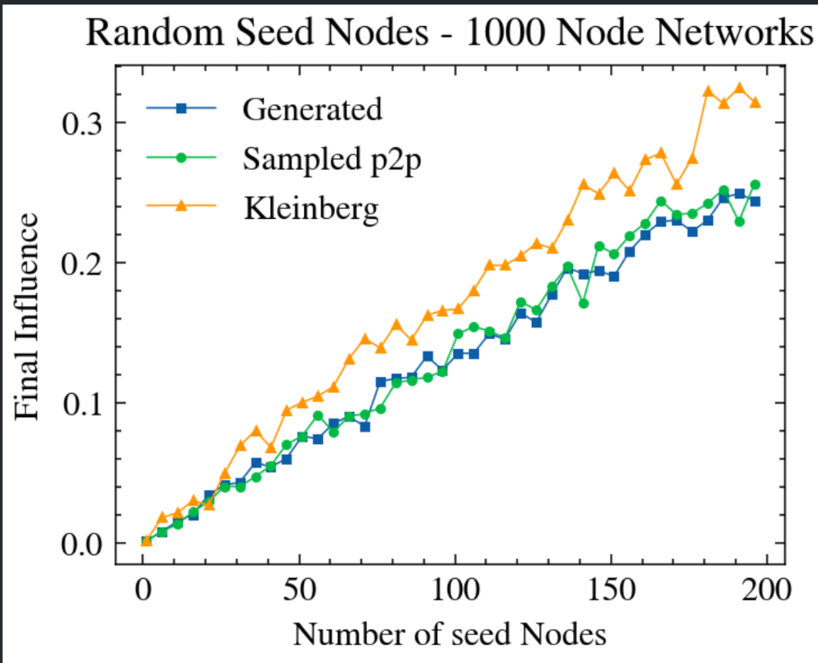
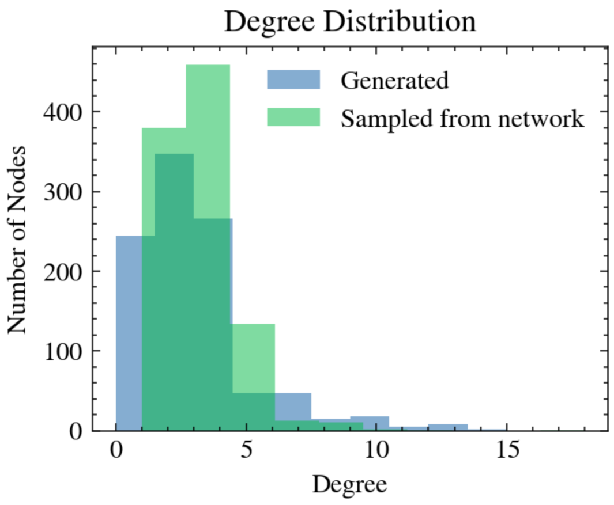
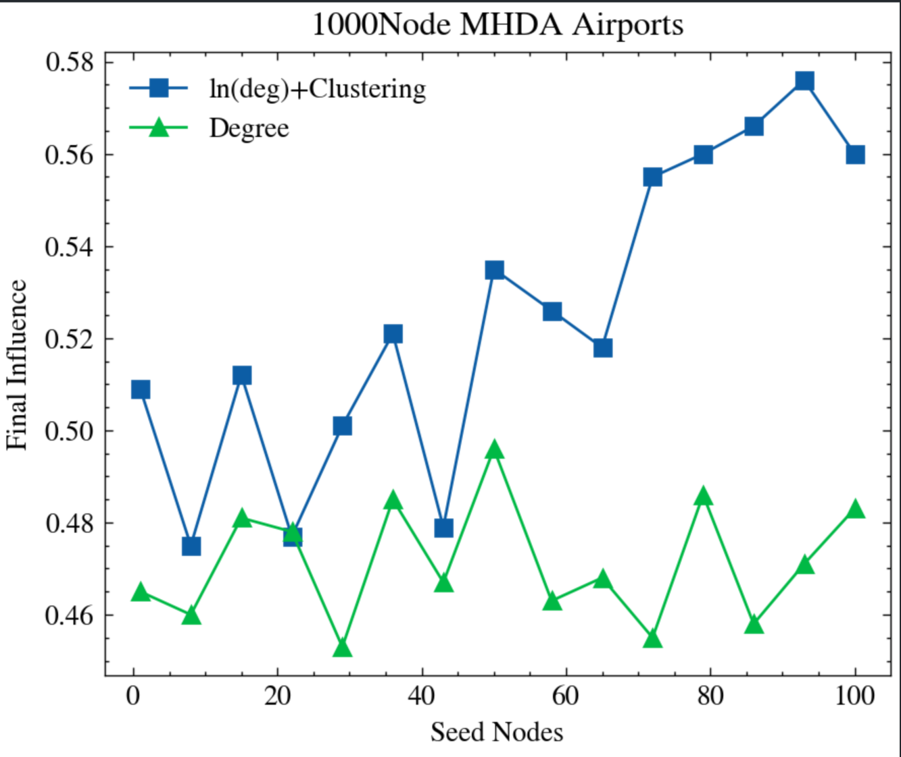
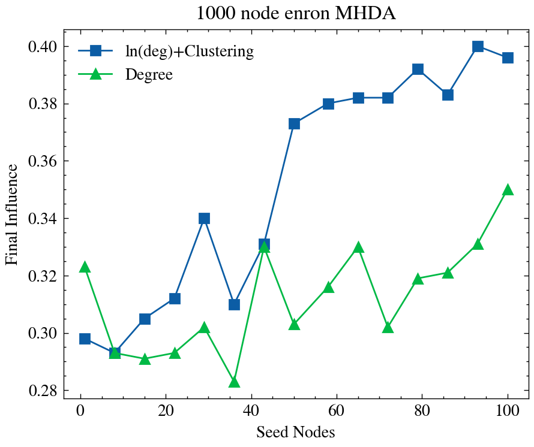
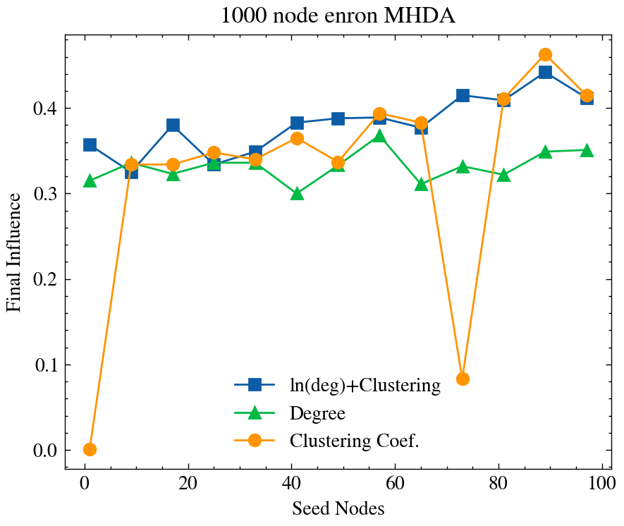
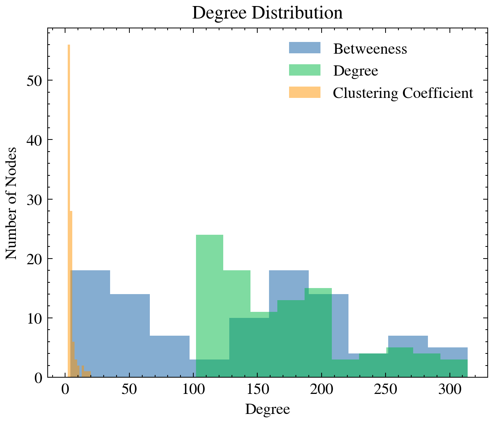
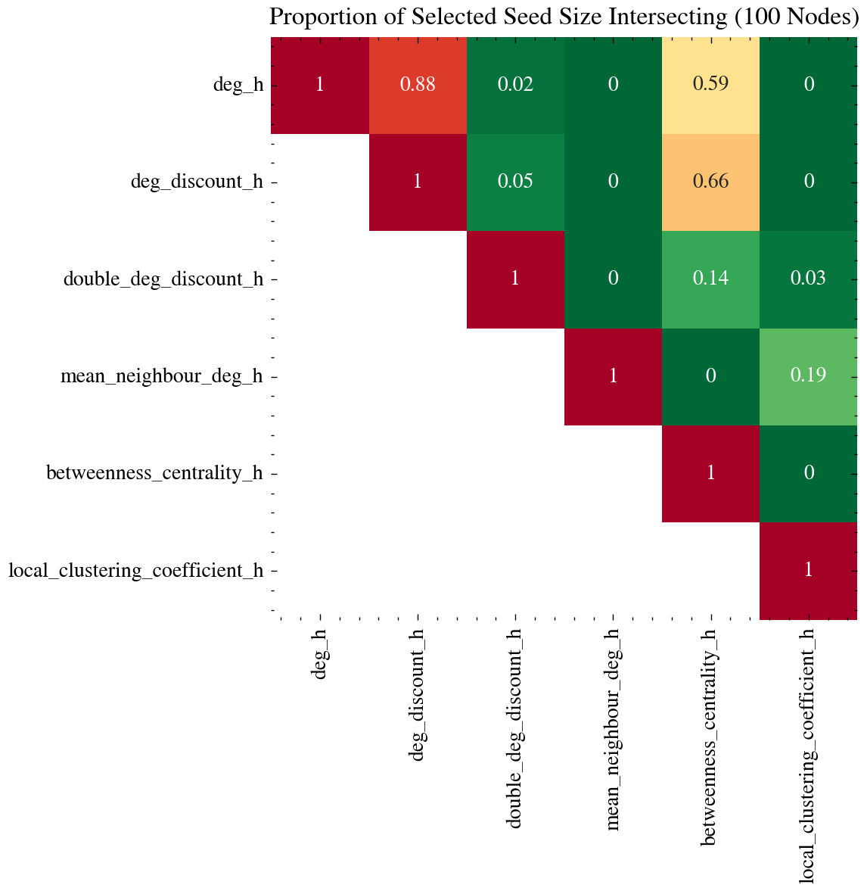
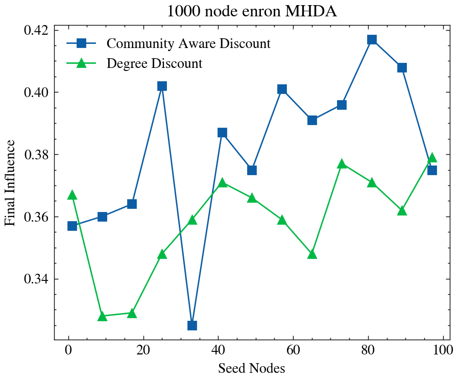
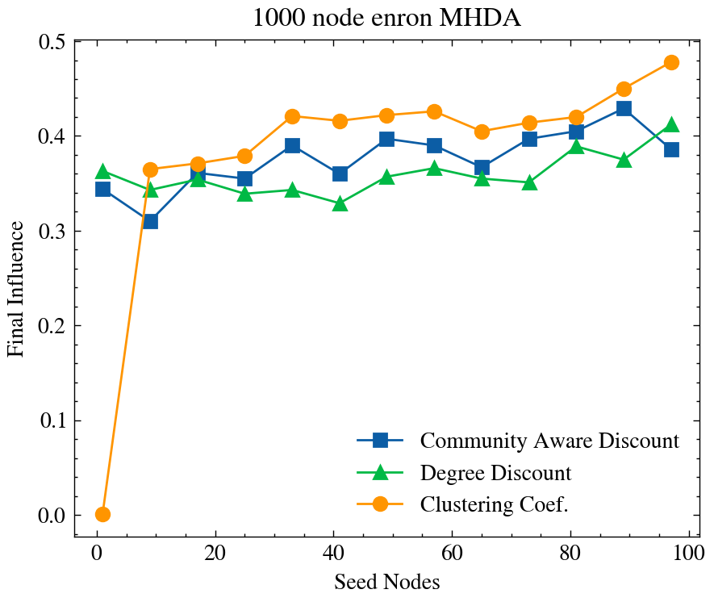
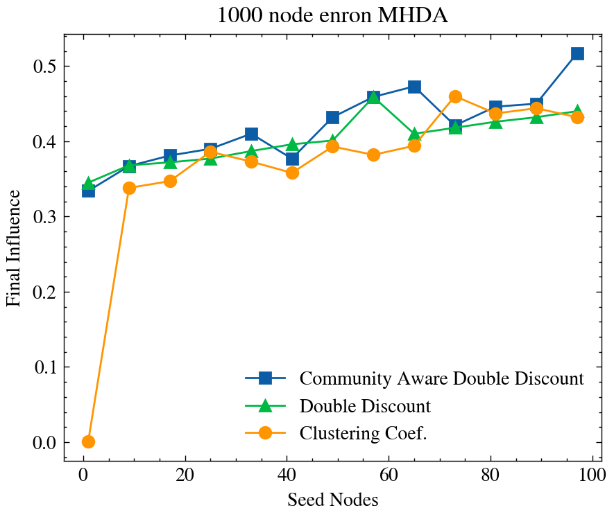

# 9th Feb
# Previously Set out Tasks
1. Some kind of generator for a network which resembles the p2p network - Done-ish
2. Start on some new and better heurisitcs/methods - Sorta
3. Start on the final report - Not Done at all
4. Visualisations - Sort of fine

# Progress
Overall okay progress made so far - Really bad at procrastinating
## 1 Graph generator to resemeble p2p topology
Start with a powerlaw graph with capped maximal degrees, base degree of 3 or 4, for 5% of nodes add a connection to any other random node

As shown the influence of a random seed of nodes trends incredibly closely to the MHDA sampled p2p network and clearly deviated from the navigable small world graphs.

Not sure what I should do with this - kind of a just a tangent 

For a 1000 node network the sampled and generated networks have a similar degree distribution

## Better Heuristics
Very simple $f(k) = deg( \lceil ln(k) \rceil) + lcc(\lfloor k - ln(k) \rfloor)$

Based on degree being very good on little seed sizes, local clustering coef being much better when more nodes are selected.

With both of the networks above the behaviour is quite clearly better than a simple degree heuristic. 

Above shows more testing needs to be done but adding just a few nodes prevents the variance of clustering heuristic. Over multiple samples with the mean taken the dips in clustering would not be visible.

## Visualisations

The above can be very easily show to show overlaps or distributions of any other trait of a node or set of nodes - clustering - longest shortest path - etc....

This doesn't really give much useful insight - just random things I threw together but interesting how degree discount and betweeness are 2/3 the same set, as discount is instant to compute whilst betweeness is almost as slow as greedy.

**Showing that hybrid heuristics are clearly worth investing but I am dumb**

# Tasks for next week
1. Work further on community structure approaches
    - Choosing high influence nodes within a community or choosing nodes that are on the edges of a community - May be more visible on the linear threshold models

    
    - Community aware seems to be better - could be good as a way to cheapen the more expensive heuristic methods e.g. betweeneess or clustering as they are non linear and the communities are a fraction of the original networks 

    

    The code for this is absolutely awful and has so many fudge factors - Need to see where I want to investigate before rewriting to a non awful state.

    

    Double discount when used in community aware mode performs better than both clustering and double discount.
    Clustering is the best performing of any of the heuristics on the MHDA sampled enron datasets.

    The community one here is still slower than clustering but there are many many ways of improving this - and I think for larger networks will work out faster overall.

1. Investigate the different community detection algorithms - 
    - Compare the differences in community size distributions and how that affects choosing nodes
    - figure out a clean and scaleable way to extract relatively large communities without a large tail of tiny communities. 
    - find some way of incorporating the small communities into the larger ones efficiently, shortest paths would be slow could just go at random or even remove entirely.
2. Fix weird code edgecases, start on final report background research maybe i don't know really.

Find the point at which large communities split up into smaller ones and then see the performance regrtess or become an asymptote